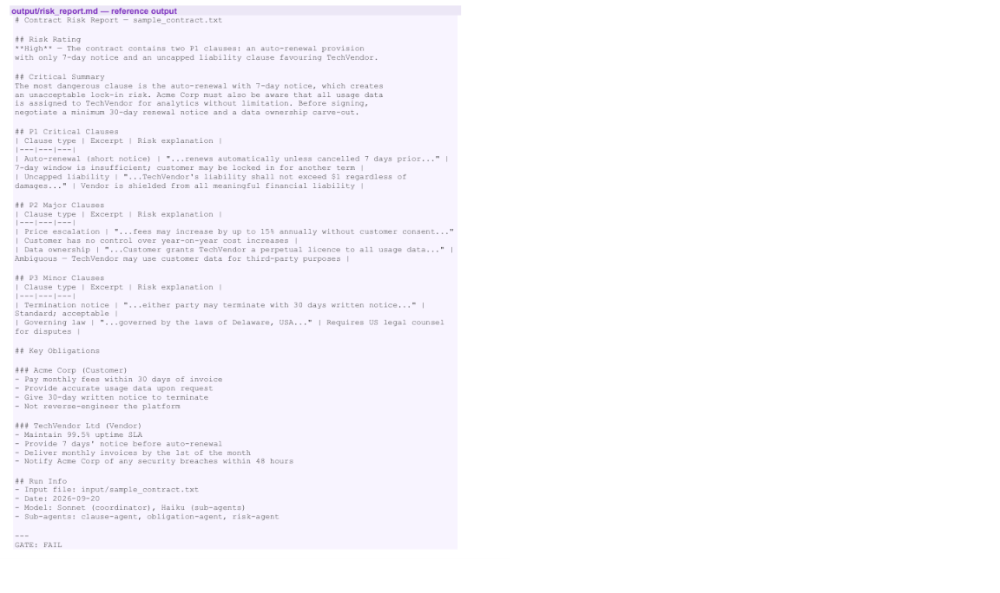

# contract-risk-scanner

Financial Contract Risk Scanner analyses a vendor contract or financial agreement (a `.txt` or `.md` file in `input/`) and writes a structured risk report to `output/risk_report.md`. A coordinator validates the input, then runs three sub-agents in parallel: one flags risky clauses by severity (P1 Critical, P2 Major, P3 Minor, each with a confidence rating), one extracts each party's key obligations, and one rates overall risk (High, Medium or Low) with a short summary. The report ends with `GATE: FAIL` if any P1 finding exists, otherwise `GATE: PASS`. Input files are never modified, and all generated files go in `output/`.

  

## Folders

- `input/` — contracts to scan. Read only.
- `output/` — all generated files: `risk_report.md`, `obligations.md`, `summary_email.md`, `validation_report.md`, `cost_log.md`.
- `.claude/agents/` — sub-agent definitions (clause, obligation, risk).
- `.claude/commands/` — slash commands (`/scan-contract`, `/extract-obligations`, `/draft-email`).
- `.claude/hooks/` _ pre_tool_use.js is a PreToolUse guardrail that blocks any file write or edit outside output/, which keeps the source contracts in input/ read-only.
- `CLAUDE.md` — project rules: model routing, severity taxonomy, output format.
- `coordinator.md` — how the coordinator validates input and merges sub-agent results.

## Severity levels

- **P1 Critical** — auto-renewal without adequate notice, uncapped liability, punitive penalties, unilateral IP or data assignment to the vendor.
- **P2 Major** — broad indemnification, exclusivity, price escalation triggers, ambiguous customer data ownership.
- **P3 Minor** — notice periods, governing law, dispute resolution forum, termination-for-convenience timelines.

Overall risk: High if any P1 finding, Medium if P2 only, Low if P3 or none.
